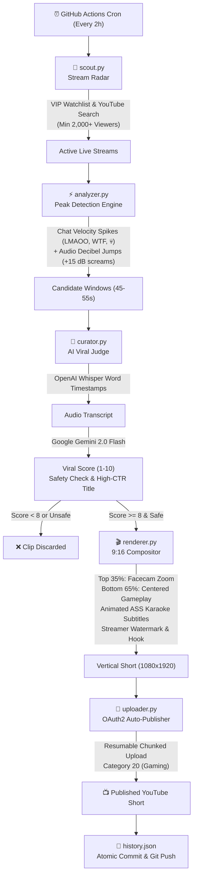

# 🎮 GTA 6 Autonomous Live Stream Scout & Auto-Clipping Shorts Engine

[](https://github.com)
[](https://youtube.com)
[](https://aistudio.google.com)
[](https://github.com/openai/whisper)
[](https://python.org)

An enterprise-grade, fully autonomous cloud engine that continuously monitors top live streamers playing **Grand Theft Auto VI** (and other viral games), pinpoints the funniest and most intense moments using **chat velocity & audio decibel spikes**, converts them into high-retention **9:16 vertical split-screen Shorts with animated karaoke subtitles and facecam zoom**, and auto-publishes them to YouTube using **GitHub Actions** (100% cloud autopilot, 0% local laptop dependency).

---

## 📑 Table of Contents
1. [System Architecture](#-system-architecture)
2. [Core Modules Overview](#-core-modules-overview)
3. [9:16 Broadcast Layout Specs](#-916-broadcast-layout-specs)
4. [Step-by-Step Setup Guide](#-step-by-step-setup-guide)
   - [1. Obtain Gemini 2.0 API Key](#1-obtain-gemini-20-api-key-free)
   - [2. Setup YouTube Data API v3 & OAuth2](#2-setup-youtube-data-api-v3--oauth2)
   - [3. Generate Persistent Refresh Token](#3-generate-persistent-refresh-token)
   - [4. Configure GitHub Actions Secrets](#4-configure-github-actions-secrets)
5. [CLI & Operational Commands](#-cli--operational-commands)
6. [Streamer VIP Watchlist Configuration](#-streamer-vip-watchlist-configuration)
7. [Zero Duplicate Protection (history.json)](#-zero-duplicate-protection-historyjson)
8. [Troubleshooting & FAQ](#-troubleshooting--faq)

---

## 🏗️ System Architecture



---

## 🧩 Core Modules Overview

| Module | Filename | Primary Responsibility |
|---|---|---|
| **Stream Radar** | `scout.py` | Scans VIP streamer channels (`/@streamer/live`) and global YouTube search for active GTA 6 streams with 2,000+ viewers. Supports both YouTube Data API and zero-quota scraping fallback. |
| **Peak Detection** | `analyzer.py` | Extracts candidate 40-55 second highlight moments without downloading the full multi-hour stream. Analyzes live chat replay density and lightweight audio RMS volume spikes (screams/laughter). |
| **AI Viral Judge** | `curator.py` | Transcribes audio with word-level timestamps using OpenAI Whisper. Sends transcript + context to Google Gemini 2.0 Flash to evaluate viral score (rejects < 8/10), safety check, and author high-CTR titles and hook banners. |
| **9:16 Compositor** | `renderer.py` | Downloads *only* the approved 48s time window via `yt-dlp`. Composites a broadcast 1080x1920 layout: 35% zoomed facecam on top, 65% gameplay on bottom, sleek neon divider, streamer credit watermark, and word-by-word bouncing ASS karaoke subtitles. |
| **Headless Publisher** | `uploader.py` | Authenticates via persistent OAuth2 refresh tokens. Performs resumable chunked upload to YouTube with exponential backoff. Sets title, attribution description, tags, and gaming category. |
| **State Tracker** | `history.json` | Stores video IDs and timestamp intervals of previously created clips to prevent duplicate uploads across runs. |
| **Cloud Autopilot** | `.github/workflows/daily_stream_scout.yml` | GitHub Actions workflow executing every 2 hours on Ubuntu cloud runners. Installs FFmpeg with `libass`, runs pipeline, and auto-commits updated `history.json`. |

---

## 📱 9:16 Broadcast Layout Specs

Every Short generated adheres to YouTube Shorts algorithm retention standards:

```
+------------------------------------------+ (1080 x 1920 Canvas)
|                                          |
|      TOP SECTION: 35% HEIGHT (672px)     |
|      Streamer Reaction / Facecam Zoom    |
|      (Auto-zoomed on emotional climax)   |
|                                          |
|  🎮 Credit: @IShowSpeed                  | (Watermark pill)
+==========================================+ [Neon Divider Line - Y:670]
|  🔥 WAIT FOR THE ENDING 💀               | (Top Hook Banner)
|                                          |
|                                          |
|      BOTTOM SECTION: 65% HEIGHT (1248px) |
|      Centered GTA 6 Gameplay Action      |
|                                          |
|                                          |
|             [ BRO JUST CRASHED ]         | (Animated ASS Karaoke Subtitles)
|                                          | (Active word popped in bright yellow)
|                                          |
+------------------------------------------+ (Y: 1920)
```

- **Video Resolution:** `1080x1920` (9:16 Vertical, 30/60 fps).
- **Duration:** 42 to 55 seconds (optimum Shorts retention window).
- **Subtitles:** ASS karaoke subtitles with word-by-word animation and yellow highlight (`&H0000E5FF`). Placed safely at Y:1500 to avoid covering YouTube Shorts UI buttons.

---

## 🚀 Step-by-Step Setup Guide

### 1. Obtain Gemini 2.0 API Key (Free)
1. Navigate to **[Google AI Studio](https://aistudio.google.com/app/apikey)**.
2. Click **Create API Key**.
3. Copy your key (starts with `AIzaSy...`).

---

### 2. Setup YouTube Data API v3 & OAuth2
To enable cloud uploads without manual login:
1. Go to **[Google Cloud Console](https://console.cloud.google.com/)**.
2. Create a project named `GTA6-Shorts-Engine`.
3. Enable the **YouTube Data API v3** under **APIs & Services > Library**.
4. Configure the **OAuth Consent Screen**:
   - User Type: **External**.
   - App Name: `GTA 6 Shorts Engine`.
   - Developer contact email: your email.
   - Publishing Status: **Testing** (Add your own Google email under **Test Users**).
5. Go to **Credentials > Create Credentials > OAuth client ID**:
   - Application Type: **Desktop app**.
   - Name: `Shorts Publisher CLI`.
   - Download the JSON credentials file and rename it to `client_secrets.json` in this directory.

---

### 3. Generate Persistent Refresh Token
Run the included helper script once on your computer:

```bash
# 1. Install dependencies
pip install -r requirements.txt

# 2. Run OAuth helper
python setup_oauth.py
```

A browser window will open. Sign in with the YouTube account where you want your Shorts published, and accept the upload permissions.

The script will output your credentials:
```text
======================================================================
SUCCESS! YOUTUBE REFRESH TOKEN GENERATED
======================================================================
YOUTUBE_CLIENT_ID=xxxxxxxxxxxx.apps.googleusercontent.com
YOUTUBE_CLIENT_SECRET=GOCSPX-xxxxxxxxxxxxxxxxxxxxxxxx
YOUTUBE_REFRESH_TOKEN=1//04xxxxxxxxxxxxxxxxxxxxxxxxxxxxxxxxxxxx
======================================================================
```

Paste these into your local `.env` file for local testing.

---

### 4. Configure GitHub Actions Secrets
To run 100% autonomously in the cloud:
1. Push this repository to GitHub:
   ```bash
   git init
   git add .
   git commit -m "feat: initial GTA 6 Shorts Engine"
   git branch -M main
   git remote add origin https://github.com/<your-username>/gta6-shorts-engine.git
   git push -u origin main
   ```
2. In your GitHub repo, navigate to **Settings > Secrets and variables > Actions**.
3. Under **Repository secrets**, add:

| Secret Name | Value |
|---|---|
| `GEMINI_API_KEY` | Your Google Gemini API Key |
| `YOUTUBE_CLIENT_ID` | Your OAuth2 Client ID |
| `YOUTUBE_CLIENT_SECRET` | Your OAuth2 Client Secret |
| `YOUTUBE_REFRESH_TOKEN` | The generated persistent refresh token |
| `YOUTUBE_API_KEY` | (Optional) YouTube Data API key for scouting |

4. Under **Settings > Actions > General > Workflow permissions**:
   - Select **Read and write permissions** (allows the bot to commit updated `history.json`).
   - Check **Allow GitHub Actions to create and approve pull requests**.

🎉 **That's it!** The engine is now completely autonomous. It will wake up every 2 hours, scout live streams, detect viral peaks, curate with Gemini 2.0, render vertical shorts, publish them to your channel, and commit the history log.

---

## 💻 CLI & Operational Commands

You can also run the engine locally anytime:

### 1. Run Full Autonomous Cycle
```bash
python main.py run
```

### 2. Dry-Run Mode (Render video locally, skip YouTube upload)
```bash
python main.py run --dry-run
```
*Rendered 1080x1920 MP4 files will be saved in the `./output/` folder.*

### 3. Scout Radar Only
Scan all VIP streamers and YouTube search without clipping:
```bash
python main.py scout
```

### 4. Clip a Specific Stream or VOD On-Demand
Want to immediately clip an insane stream moment from any YouTube link?
```bash
python main.py clip \
  --url "https://www.youtube.com/watch?v=VIDEO_ID" \
  --streamer "IShowSpeed" \
  --handle "@IShowSpeed"
```

### 5. Target a Specific Streamer
```bash
python main.py run --streamer "Kai Cenat" --max-shorts 1
```

---

## 👥 Streamer VIP Watchlist Configuration

Configure target streamers, channel IDs, and facecam crop coordinates in `streamers.json`:

```json
[
  {
    "name": "IShowSpeed",
    "handle": "@IShowSpeed",
    "channel_id": "UCWsDIT66Ccg_d1H9x_8tBTA",
    "custom_url": "https://www.youtube.com/@IShowSpeed",
    "live_url": "https://www.youtube.com/@IShowSpeed/live",
    "facecam_position": "top-right",
    "facecam_box": [0.70, 0.03, 0.28, 0.36],
    "language": "en",
    "enabled": true
  }
]
```

### Facecam Box Normalized Coordinates:
- Format: `[x_offset, y_offset, width, height]` (all values between 0.0 and 1.0).
- **Top-Right Cam:** `[0.70, 0.03, 0.28, 0.36]`
- **Top-Left Cam:** `[0.03, 0.03, 0.28, 0.36]`
- **Bottom-Right Cam:** `[0.70, 0.60, 0.28, 0.36]`

---

## 🛡️ Zero Duplicate Protection (`history.json`)

To prevent duplicate uploads, the engine maintains an atomic registry in `history.json`:
- Tracks every processed video ID.
- Tracks exact start and end timestamps of clipped sections.
- Rejects candidate windows that overlap (>15s) with existing clips.
- Automatically committed and pushed to your repo by GitHub Actions after every run.

---

## ❓ Troubleshooting & FAQ

### Q: Does this download 4-hour live stream videos to my runner?
**No.** The engine uses `yt-dlp`'s `--download-sections "*start-end"` to download *strictly* the selected 48-second highlight slice. Network bandwidth is ~25-40 MB per clip, finishing in seconds and easily fitting GitHub Actions free runner quotas.

### Q: What if a streamer doesn't have live chat replay enabled?
The engine uses a two-tiered fallback:
1. First checks chat velocity and viral keywords.
2. If chat replay is missing, it scans lightweight audio for **RMS decibel volume spikes** (+15 dB screams/laughter).
3. If both are flat, it captures the stream's recent climax window.

### Q: How are YouTube copyright / fair use guidelines addressed?
- The engine automatically renders a permanent attribution badge: `🎮 Credit: @StreamerHandle`.
- Descriptions include clear attribution, links to the original full stream, and standard fair use commentary/critique notices.
- Uploads can be set to `UPLOAD_PRIVACY_STATUS=unlisted` in `.env` if you prefer manual final review before making them public.

---

## 📜 License
Distributed under the MIT License. See `LICENSE` for more information.
